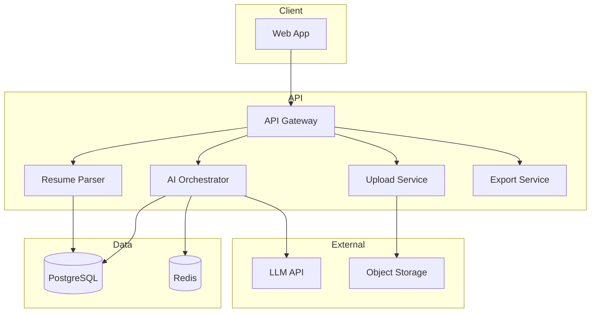

# AI 简历优化网站 — 产品需求文档（PRD）

| 版本 | 日期 | 作者 | 说明 |
|------|------|------|------|
| v1.0 | 2026-06-01 | Product | 初版 |

---

## 1. 文档概述

### 1.1 背景

程序员在求职过程中，简历往往是获得面试机会的第一道门槛。常见问题包括：技术亮点表达不清、项目经历缺乏量化、关键词与目标岗位不匹配、格式不利于 ATS（Applicant Tracking System）解析等。

本产品旨在通过 AI 能力，帮助程序员**上传现有简历 → 获得结构化分析 → 获取可执行的优化建议 → 一键生成优化后的新版简历**，缩短简历打磨周期，提高简历通过率。

### 1.2 产品定位

**面向程序员的一站式 AI 简历优化工具**，强调「技术简历专业性」与「可落地修改」，而非泛泛的文案润色。

### 1.3 产品愿景

成为程序员求职链路中「简历准备」环节的首选工具：5 分钟内完成一次专业级简历诊断与优化。

---

## 2. 目标用户

### 2.1 核心用户画像

| 维度 | 描述 |
|------|------|
| 身份 | 找工作的程序员（初级 ~ 高级） |
| 场景 | 跳槽、应届校招、转行编程、外包/自由职业转全职 |
| 痛点 | 不知道简历差在哪、不会写项目亮点、投很多岗位无回音 |
| 期望 | 快速得到专业反馈，并能直接产出可用的新简历 |

### 2.2 用户细分

| 细分 | 特征 | 核心需求 |
|------|------|----------|
| **应届生** | 项目/实习经历少，技能堆砌 | 挖掘课程/竞赛/开源价值，补全结构 |
| **1~3 年工程师** | 有项目但描述流水账 | 量化成果、突出技术深度与业务影响 |
| **3~5 年工程师** | 经历多，篇幅失控 | 裁剪冗余、按目标岗位重组优先级 |
| **高级/架构师** | 需体现领导力与系统设计 | 突出架构决策、团队影响、技术选型理由 |

### 2.3 非目标用户（v1 不做）

- 非技术岗位求职者
- 需要真人 1v1 职业咨询的用户（可作为后续增值服务）
- 企业 HR 批量筛简历场景

---

## 3. 问题陈述与产品目标

### 3.1 用户核心问题

1. **诊断盲区**：自己看不出简历的问题，缺少对照标准。
2. **表达低效**：技术做了很多事，但写不出「面试官想看的」表述。
3. **岗位不匹配**：同一份简历投前端/后端/全栈，未做针对性优化。
4. **格式与 ATS**：排版混乱或过于花哨，导致系统解析失败。
5. **修改成本高**：知道要改，但从零重写费时费力。

### 3.2 产品目标

| 目标 | 说明 | 衡量方式 |
|------|------|----------|
| **快** | 上传后 60 秒内出分析报告 | P95 分析耗时 ≤ 60s |
| **准** | 建议贴合程序员简历规范 | 用户满意度 ≥ 4.2/5 |
| **能用** | 生成的简历可直接下载使用 | 下载率 / 二次编辑率 |
| **可行动** | 每条建议可对应到具体修改 | 建议采纳率 |

### 3.3 成功指标（North Star & 关键指标）

- **North Star Metric**：成功生成并下载优化版简历的用户数（Weekly Generated Resumes）
- **激活**：完成首次上传并完成分析的用户占比
- **留存**：7 日内再次优化或针对新 JD 优化的用户占比
- **转化**（若后续商业化）：免费 → 付费转化率

---

## 4. 功能需求

### 4.1 功能全景图

```
上传简历 → 解析结构化 → AI 分析评分 → 优化建议 → 交互式修改 → 生成新版简历 → 导出
                ↑                              ↑
           目标岗位/JD（可选）            版本对比 / 历史记录
```

### 4.2 功能清单与优先级

| 模块 | 功能 | 优先级 | 说明 |
|------|------|--------|------|
| 简历上传 | 支持 PDF / DOCX / Markdown / 纯文本 | P0 | 主流格式全覆盖 |
| 简历上传 | 拖拽上传 + 粘贴文本 | P0 | 降低使用门槛 |
| 简历解析 | 结构化抽取（个人信息、技能、经历、项目、教育） | P0 | 分析的基础 |
| AI 分析 | 综合评分 + 分项评分 | P0 | 量化反馈 |
| AI 分析 | 问题清单（按严重程度排序） | P0 | 可行动反馈 |
| 优化建议 | 分模块建议（技能/项目/工作经历/教育/排版） | P0 | 对应修改位置 |
| 优化建议 | 针对目标 JD 的匹配度分析 | P1 | 提高投递命中率 |
| 简历生成 | 一键生成优化版 | P0 | 核心价值 |
| 简历生成 | 多模板选择（简洁/技术/ATS 友好） | P1 | 程序员偏好简洁 |
| 导出 | PDF / Markdown / DOCX 下载 | P0 | 可直接投递 |
| 账户 | 游客试用 + 注册保存历史 | P1 | 促进留存 |
| 对比 | 原版 vs 优化版 diff 对比 | P1 | 增强信任感 |
| 历史 | 多版本管理 | P2 | 针对不同岗位 |

---

## 5. 详细功能说明

### 5.1 简历上传

#### 5.1.1 用户故事

> 作为求职者，我希望快速上传我的简历，以便 AI 开始分析。

#### 5.1.2 功能描述

- 支持格式：`.pdf`、`.docx`、`.md`、`.txt`
- 上传方式：拖拽、点击选择、直接粘贴文本
- 文件限制：单文件 ≤ 10MB，页数建议 ≤ 5 页
- 上传前可选填：
  - **目标岗位**（如：Java 后端工程师）
  - **目标 JD**（粘贴职位描述，用于匹配分析）
  - **工作年限**（辅助 AI 判断深度预期）

#### 5.1.3 交互要求

- 上传过程展示进度条
- 解析失败时给出明确原因（加密 PDF、扫描件、格式损坏）及替代方案（粘贴文本）
- 解析成功后展示「简历预览卡片」供用户确认结构是否正确

#### 5.1.4 验收标准

- [ ] PDF/DOCX/MD/TXT 均可成功上传
- [ ] 10MB 以内文件 5 秒内进入解析
- [ ] 解析失败有友好错误提示
- [ ] 用户可手动修正解析错误的字段

---

### 5.2 简历解析（结构化）

#### 5.2.1 输出结构

```json
{
  "basicInfo": {
    "name": "string",
    "email": "string",
    "phone": "string",
    "location": "string",
    "links": ["GitHub", "Blog", "LinkedIn"]
  },
  "summary": "string",
  "skills": {
    "languages": [],
    "frameworks": [],
    "tools": [],
    "other": []
  },
  "workExperience": [
    {
      "company": "string",
      "title": "string",
      "duration": "string",
      "highlights": ["string"]
    }
  ],
  "projects": [
    {
      "name": "string",
      "role": "string",
      "techStack": [],
      "description": "string",
      "achievements": ["string"]
    }
  ],
  "education": [],
  "certifications": [],
  "others": []
}
```

#### 5.2.2 特殊处理（程序员场景）

- 识别并分类技术栈关键词（语言、框架、中间件、云服务等）
- 识别 GitHub / 博客 / 技术社区链接
- 区分「工作经历中的项目」与「独立项目/Open Source」
- 检测是否包含量化指标（QPS、延迟、用户量、成本节约等）

---

### 5.3 AI 分析

#### 5.3.1 用户故事

> 作为求职者，我希望知道我的简历哪里不好、严重程度如何，以便优先修改。

#### 5.3.2 评分体系

**综合得分：0 ~ 100**

| 维度 | 权重 | 评估内容 |
|------|------|----------|
| 内容完整性 | 20% | 关键模块是否齐全，联系方式、技能、项目是否缺失 |
| 技术表达 | 25% | 技术栈是否清晰、深度是否匹配年限、有无 buzzword 堆砌 |
| 项目质量 | 25% | 是否有背景/行动/结果、是否量化、是否体现个人贡献 |
| 岗位匹配 | 20% | 与目标 JD 的关键词/能力要求重合度（若提供 JD） |
| 格式与可读性 | 10% | 篇幅、层次、ATS 友好度、错别字 |

**等级映射**

| 分数 | 等级 | 文案 |
|------|------|------|
| 90~100 | A | 优秀，稍作微调即可投递 |
| 75~89 | B | 良好，有几处可显著提升 |
| 60~74 | C | 一般，建议重点优化项目与技能 |
| < 60 | D | 需要较大幅度修改 |

#### 5.3.3 分析报告内容

1. **总评摘要**（2~3 句话，直接点明最大问题）
2. **雷达图/分项得分**
3. **问题清单**（按 P0/P1/P2 优先级）
   - 问题描述
   - 影响说明（为什么面试官会在意）
   - 所在位置（对应简历段落）
4. **亮点识别**（已有优势，避免 AI 负向打击）
5. **JD 匹配报告**（若提供 JD）
   - 已覆盖关键词
   - 缺失关键词
   - 建议补充的能力点

#### 5.3.4 分析原则（AI Prompt 约束）

- 建议必须**具体、可执行**，禁止空泛评价（如「建议丰富项目经历」）
- 使用程序员语境（性能、架构、工程化、业务指标）
- 区分「必须改」与「可选优化」
- 对初级用户避免过度要求（如不要求应届生一定有分布式经验）

---

### 5.4 优化建议

#### 5.4.1 用户故事

> 作为求职者，我希望看到逐条、可落地的修改建议，并能理解改完会变成什么样。

#### 5.4.2 建议类型

| 类型 | 示例 |
|------|------|
| **重写建议** | 将「负责后端开发」改为「主导订单模块 API 设计，支撑日活 10 万+，P99 延迟从 800ms 降至 120ms」 |
| **结构调整** | 建议将「个人项目」提前，因工作经历较短 |
| **技能优化** | 删除「熟悉 XXX」堆砌，按熟练度分组排列 |
| **删除建议** | 移除与目标岗位无关的内容（如投后端却大篇幅写 UI） |
| **补充建议** | 建议增加 GitHub 链接、开源贡献、技术博客 |
| **格式建议** | 控制一页/两页、统一日期格式、避免表格过多 |

#### 5.4.3 交互设计

- 每条建议以「卡片」展示：`问题 → 原因 → 建议改法 → 示例（Before/After）`
- 用户可：**采纳 / 忽略 / 编辑后采纳**
- 支持按模块筛选：技能 / 项目 / 工作经历 / 教育 / 整体
- 底部汇总：已采纳 N 条，预计可提升 X 分（估算）

---

### 5.5 生成新版简历

#### 5.5.1 用户故事

> 作为求职者，我希望一键应用建议生成新简历，并能预览、微调后导出。

#### 5.5.2 生成逻辑

1. 以结构化数据 + 用户采纳的建议为输入
2. AI 生成优化后的各模块文案
3. 套用用户所选模板渲染
4. 展示「原版 vs 新版」对比视图

#### 5.5.3 模板（v1 至少 2 款）

| 模板 | 特点 | 适用 |
|------|------|------|
| **极简 ATS** | 纯文本结构、无复杂排版 | 大厂网申、ATS 系统 |
| **技术风** | 清晰分区、技能标签、GitHub 突出 | 互联网技术岗 |
| **单栏经典** | 传统简洁，通用 | 国企/传统行业 |

#### 5.5.4 生成后编辑

- 支持在线编辑各字段（富文本/Markdown）
- 修改后实时预览
- 支持「重新生成某一节」（如仅重新生成项目经历）

#### 5.5.5 导出

- 格式：PDF（必做）、Markdown（必做）、DOCX（P1）
- PDF 要求：嵌入字体、A4、可复制文本（非图片 PDF）
- 文件命名默认：`姓名_岗位_简历_日期.pdf`

---

## 6. 用户流程

### 6.1 主流程（Happy Path）


### 6.2 关键页面

| 页面 | 核心元素 |
|------|----------|
| **首页** | 价值主张、上传入口、示例报告预览、社会证明（可选） |
| **上传页** | 上传区、JD 输入、解析预览 |
| **分析报告页** | 综合分、雷达图、问题列表、JD 匹配 |
| **建议页** | 分模块建议卡片、采纳操作 |
| **生成页** | 模板选择、左右对比、在线编辑器 |
| **导出页** | 下载按钮、分享链接（P2） |

### 6.3 异常流程

| 场景 | 处理 |
|------|------|
| 上传扫描版 PDF（无文本层） | 提示 OCR 能力（P2）或引导粘贴文本 |
| AI 超时 | 展示 loading + 异步通知，允许稍后查看 |
| 生成内容用户不满意 | 提供「换一版」/「仅重写本节」 |
| 敏感信息 | 上传前提示可脱敏，不存储原始文件（可配置） |

---

## 7. 信息架构

```
AI Resume Optimizer
├── 首页
├── 优化流程
│   ├── 上传
│   ├── 分析报告
│   ├── 优化建议
│   └── 生成 & 导出
├── 我的简历（登录后）
│   ├── 历史版本
│   └── 账户设置
└── 帮助
    ├── 使用指南
    └── 隐私说明
```

---

## 8. AI 能力设计

### 8.1 模型任务拆分

| 任务 | 输入 | 输出 | 建议 |
|------|------|------|------|
| 解析 | 原始文本 | 结构化 JSON | 专用解析 Prompt + JSON Schema 校验 |
| 分析 | 结构化简历 + JD | 评分 + 问题列表 | 分维度 Rubric 打分 |
| 建议 | 分析结果 + 原文 | 逐条建议 + Before/After | 限制每条建议字数 |
| 生成 | 结构化数据 + 采纳建议 | 优化后 JSON / Markdown | 保持事实不捏造 |

### 8.2 质量与安全约束

- **禁止捏造**：不得虚构公司、项目、数字；若信息不足，建议用户补充而非编造
- **可解释性**：每条建议需说明依据
- **一致性**：同一简历多次分析，评分波动应 ≤ 5 分（通过 temperature 控制）
- **隐私**：简历内容加密存储，用户可一键删除；不用于模型训练（默认）

### 8.3 Prompt 设计要点（程序员简历）

分析时重点检查：

1. 项目是否体现 **STAR**（Situation/Task/Action/Result）
2. 是否包含 **量化指标**（性能、规模、效率、质量）
3. 技术栈是否与 **目标岗位** 对齐
4. 是否体现 **工程化能力**（CI/CD、测试、监控、Code Review）
5. 高级岗位是否体现 **架构/选型/权衡/团队协作**

---

## 9. 非功能需求

### 9.1 性能

| 指标 | 要求 |
|------|------|
| 页面首屏 | ≤ 2s（国内 CDN） |
| 文件上传 | ≤ 5s（10MB） |
| AI 分析 | P95 ≤ 60s |
| 简历生成 | P95 ≤ 30s |

### 9.2 可用性

- 核心流程 ≤ 5 步完成
- 移动端可完成上传与查看报告（编辑可简化）
- 支持中英文简历（v1 优先中文，界面中文）

### 9.3 安全与合规

- HTTPS 全站
- 文件病毒扫描
- 个人信息最小化采集
- 《隐私政策》《用户协议》
- 符合《个人信息保护法》

### 9.4 兼容性

- 浏览器：Chrome / Safari / Edge 最新两个大版本
- 导出 PDF 在 macOS Preview、Adobe Reader 正常显示

---

## 10. 数据模型（概要）

### 10.1 核心实体

```
User
  - id, email, createdAt

Resume
  - id, userId, rawFileUrl, structuredData, targetRole, targetJd, createdAt

Analysis
  - id, resumeId, overallScore, dimensionScores, issues[], highlights[], jdMatch, createdAt

Suggestion
  - id, analysisId, module, priority, problem, reason, suggestion, before, after, status(accepted/ignored)

ResumeVersion
  - id, resumeId, template, content, source(suggestionIds), createdAt
```

### 10.2 数据保留策略

- 游客：24 小时自动清理
- 注册用户：默认保留 90 天，可手动删除
- 原始上传文件：解析完成后可选删除，仅保留结构化数据

---

## 11. 技术方案建议

### 11.1 推荐技术栈

| 层级 | 建议 |
|------|------|
| 前端 | Next.js + React + Tailwind CSS |
| 后端 | Node.js (NestJS) 或 Python (FastAPI) |
| AI | OpenAI / Claude API + Prompt 编排 |
| 文件解析 | pdf-parse、mammoth（docx）、自研 MD 解析 |
| 存储 | PostgreSQL + S3/OSS |
| 队列 | Redis + Bull（异步 AI 任务） |
| 部署 | Vercel（前端）+ 云服务器/容器（后端） |

### 11.2 系统架构



---

## 12. MVP 范围与迭代计划

### 12.1 MVP（4~6 周）

**必须有：**

- [ ] PDF/TXT 上传 + 文本粘贴
- [ ] 简历结构化解析
- [ ] AI 综合评分 + 5 维度分析
- [ ] 分模块优化建议（含 Before/After 示例）
- [ ] 一键生成优化版（1 个 ATS 模板）
- [ ] PDF + Markdown 导出
- [ ] 原版 vs 新版对比

**可以没有：**

- 用户登录
- JD 匹配
- 多模板
- DOCX 导出
- 历史版本

### 12.2 V1.1

- 注册登录 + 历史记录
- JD 粘贴 + 匹配度分析
- 第二套「技术风」模板
- DOCX 导出

### 12.3 V2.0

- 一简历多岗位版本管理
- OCR 扫描件识别
- 英文简历
- 简历 + 求职信联动生成
- 付费高级版（无限次数、更快模型、人工复核）

---

## 13. 商业化思路（可选）

| 模式 | 说明 |
|------|------|
| **Freemium** | 免费 1 次完整优化/月，付费无限次 |
| **单次付费** | ¥9.9 / 次完整优化 + 导出 |
| **订阅** | ¥29/月，含历史管理、JD 匹配、多模板 |
| **B 端** | 培训机构/猎头批量账号 |

MVP 阶段建议：**完全免费**，验证产品价值与留存后再开启付费。

---

## 14. 风险与应对

| 风险 | 影响 | 应对 |
|------|------|------|
| AI 捏造经历 | 用户诚信与产品信任 | 严格 Prompt + 用户确认 + 不自动添加未提供信息 |
| 解析准确率低 | 分析结论偏差 | 允许用户修正结构化结果后再分析 |
| LLM 成本高 | 毛利压力 | 缓存相似请求、分层模型（小模型解析+大模型生成） |
| 同质化竞争 | 获客难 | 聚焦「程序员垂直场景」与「可导出可用」 |
| 隐私顾虑 | 上传意愿低 | 明示数据用途、支持即时删除、可选不留原文件 |

---

## 15. 附录

### 15.1 竞品参考

| 产品 | 优势 | 差距机会 |
|------|------|----------|
| 通用 AI 写作工具 | 品牌强 | 不垂直、不懂技术简历 |
| 海外 Resume AI | 模板多 | 中文/国内求职场景弱 |
| 人工简历服务 | 质量高 | 贵、慢、不可复用 |

**差异化**：程序员语境 + 结构化分析 + 中外技术栈识别 + 一键可用输出。

### 15.2 首页文案示例

> **让 AI 帮程序员改简历，而不只是改语法**
>
> 上传简历，60 秒获得专业诊断：项目怎么写、技能怎么排、哪里该删 —— 一键生成可直接投递的新版简历。

### 15.3 术语表

| 术语 | 说明 |
|------|------|
| ATS | Applicant Tracking System，招聘管理系统，许多公司用其自动筛简历 |
| JD | Job Description，职位描述 |
| STAR | 情境-任务-行动-结果，项目描述常用框架 |

---

## 16. 验收清单（Release Criteria）

MVP 上线前需满足：

- [ ] 用户可在 3 分钟内完成「上传 → 分析 → 建议 → 生成 → 下载」全流程
- [ ] 支持 PDF、TXT 上传及文本粘贴
- [ ] 分析报告包含综合分、分项分、≥5 条具体建议
- [ ] 生成的 PDF 可被正常打开且文本可选中复制
- [ ] 无 P0/P1 级 bug
- [ ] 隐私政策页面上线
- [ ] 错误场景均有用户可理解的提示

---

*文档结束*
